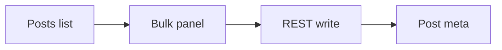

## intent

Ship bulk field edit from the posts list so editors avoid opening each post. Grounded in `.harness/state.md` Behavior & Test Contracts.

## decisions

- Panel over inline edit (from UX plan D1).
- Capability `edit_posts` plus nonce on the write route.

## map



## hotspots

```html
<div class="diff-file" aria-label="BulkEditPanel changes">
  <div class="diff-file__header">
    <span class="diff-file__badge">Code changes</span>
    <span>src/BulkEditPanel.tsx</span>
    <span class="diff-file__meta">+12 −3</span>
  </div>
  <div class="diff-file__body">
    <div class="diff-line diff-line--ctx"><span class="diff-line__num">1</span><span class="diff-line__mark"> </span><code class="diff-line__code">// open panel from list</code></div>
    <div class="diff-line diff-line--add"><span class="diff-line__num">2</span><span class="diff-line__mark">+</span><code class="diff-line__code">confirmBulkUpdate(field, value)</code></div>
  </div>
</div>
```

## frontend

Platform: Web. State Mermaid above. Effects: list refresh after confirm. Risks: empty value semantics still open.

## backend

PHP REST route checks capability + nonce before updating meta.

## tests

- Unit: panel validation when value rejected.
- E2E: select two posts, set field, confirm, see count.

## verify

1. Open posts list, select two drafts, run bulk edit on one field.
2. Confirm capability-denied user cannot write.
3. Check TDD Evidence in state.md is PASS.

## out

- Multi-field edit deferred.
- Mobile layout polish not in this PR.
