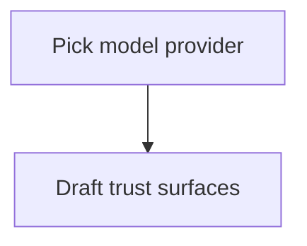

## destination

A clear v1 chatbot scope with agreed surfaces and trust boundaries ready for lens plans.

## notes

WordPress plugin; prefer grill-me for HITL tickets.

## decisions

- Use block editor only for the composer — no classic metabox.

## fog

- Streaming vs request/response for model calls.

## outofscope

- Mobile native apps.

## frontier

| Ticket | Type | Status | Blocked by |
| --- | --- | --- | --- |
| Pick model provider | grilling | open | none |

## graph

